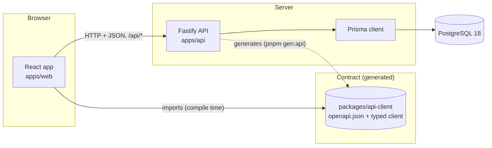
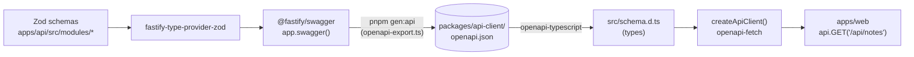
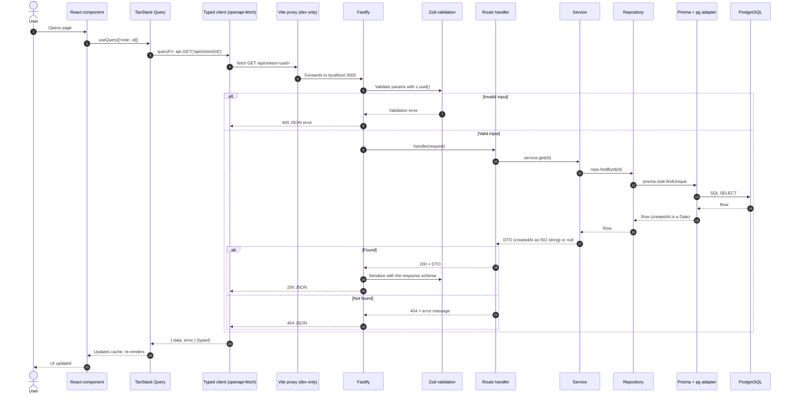
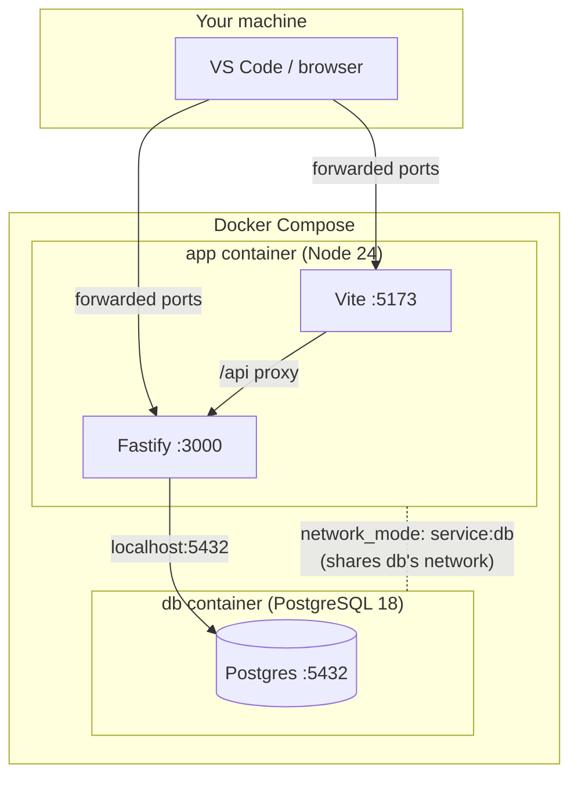

# Architecture

This document explains how the application is built, why, and how to work with it. Diagrams use [Mermaid](https://mermaid.js.org/) and render on GitHub, GitLab and in VS Code (with a Mermaid preview extension).

**Contents**

1. [Overview and principles](#1-overview-and-principles)
2. [Building blocks](#2-building-blocks)
3. [The contract: from Zod schema to typed UI call](#3-the-contract-from-zod-schema-to-typed-ui-call)
4. [Anatomy of a request](#4-anatomy-of-a-request)
5. [Back-end architecture](#5-back-end-architecture)
6. [Front end, data layer and tooling](#6-front-end-data-layer-and-tooling)
7. [Practical recipes](#7-practical-recipes)
8. [Decision log](#8-decision-log)
9. [Dos and don'ts](#9-dos-and-donts)
10. [Production readiness: what is missing](#10-production-readiness-what-is-missing)
11. [Core concepts to master](#11-core-concepts-to-master)

---

## 1. Overview and principles

The application is a **monorepo with three deployable or shareable parts**:

- `apps/web`: a React single-page application.
- `apps/api`: a Fastify REST API backed by PostgreSQL through Prisma.
- `packages/api-client`: a generated, typed client. It is the **contract** and the only code shared between front end and back end.



### Principles

1. **The contract is the boundary.** The web app cannot import database or server code, because it only depends on `packages/api-client`. This is separation enforced by package boundaries, not by discipline alone.
2. **One schema, many uses.** A Zod schema validates input, types the handler, serializes output and documents the endpoint. There is no second place to keep in sync.
3. **Framework-light core.** Business logic lives in plain functions (services, repositories) that do not import Fastify. If the HTTP framework ever needs replacing, only the route layer is rewritten.
4. **Durable foundations, replaceable edges.** HTTP, JSON, OpenAPI, SQL and PostgreSQL are the stable core. Frameworks and ORMs sit behind thin layers.
5. **One database for everything.** PostgreSQL covers relational data now, and JSON documents, full-text search and vectors (pgvector) later, so a second or third data store is not needed up front.
6. **Reproducible by default.** The dev container plus one idempotent script rebuilds the whole workspace.

---

## 2. Building blocks

> Versions are a snapshot of **14 October 2026**, as resolved at scaffold time. Items marked _pinned_ are held back deliberately. The lockfile is authoritative.

### 2.1 Tooling and environment

| Component                                                                                                               | Version                                                    | Role                                                                     | Replaceable?                      |
| ----------------------------------------------------------------------------------------------------------------------- | ---------------------------------------------------------- | ------------------------------------------------------------------------ | --------------------------------- |
| [Node.js](https://nodejs.org/)                                                                                          | 24 (Active LTS)                                            | JavaScript runtime for the API and all tooling                           | Hard; it is the platform          |
| [TypeScript](https://www.typescriptlang.org/)                                                                           | 7.0.2 in `api` and `web`; **6.0.3 pinned** in `api-client` | Static typing; `tsc` type-checks and builds the API                      | Hard; it is the language          |
| [pnpm](https://pnpm.io/)                                                                                                | 12.11.2                                                    | Package manager and workspace linker; strict `node_modules`              | Easy (npm, yarn)                  |
| [Turborepo](https://turborepo.com/)                                                                                     | 2.11.8                                                     | Runs scripts across packages in dependency order; caching                | Easy; delete it and use `pnpm -r` |
| [tsx](https://tsx.is/)                                                                                                  | 4.23.x                                                     | Runs TypeScript directly in dev (`tsx watch`) and for the OpenAPI export | Easy                              |
| [Docker](https://www.docker.com/) + Compose                                                                             | current                                                    | Runs the workspace container and PostgreSQL                              | Moderate                          |
| [Dev Containers](https://containers.dev/) ([VS Code docs](https://code.visualstudio.com/docs/devcontainers/containers)) | spec                                                       | Opens the repo inside the container; runs `setup.sh` after creation      | Easy                              |

### 2.2 Front end

| Component                                                             | Version                       | Role                                                                                                             | Replaceable? |
| --------------------------------------------------------------------- | ----------------------------- | ---------------------------------------------------------------------------------------------------------------- | ------------ |
| [React](https://react.dev/)                                           | 19.3.1                        | Component-based UI library                                                                                       | Hard         |
| [Vite](https://vite.dev/)                                             | 8.3.4                         | Dev server (hot reload, `/api` proxy) and production bundler                                                     | Moderate     |
| [`@vitejs/plugin-react`](https://github.com/vitejs/vite-plugin-react) | 6.1.2                         | React support in Vite                                                                                            | Tied to Vite |
| [Tailwind CSS](https://tailwindcss.com/)                              | 4.3.3 (+ `@tailwindcss/vite`) | Utility-first CSS with responsive breakpoints (`sm:`, `md:`, `lg:`)                                              | Moderate     |
| [TanStack Query](https://tanstack.com/query/latest)                   | 5.104.2                       | Server-state management: fetching, caching, refetching, loading and error states                                 | Easy         |
| [Better Auth client](https://www.better-auth.com/)                    | 1.7.10                        | Browser session state, sign-in/out, SSO and read-only admin user listing                                         | Moderate     |
| [shadcn/ui](https://ui.shadcn.com/)                                   | _not installed (opt-in)_      | Accessible components copied into your repo (no runtime dependency). See [Recipe 7.11](#711-recipe-add-shadcnui) | n/a          |

### 2.3 Contract

| Component                                                                                | Version | Role                                                                                      |
| ---------------------------------------------------------------------------------------- | ------- | ----------------------------------------------------------------------------------------- |
| [OpenAPI](https://www.openapis.org/) ([spec](https://spec.openapis.org/oas/latest.html)) | 3.x     | Language-neutral description of every endpoint, parameter and response. **The contract.** |
| [`@fastify/swagger`](https://github.com/fastify/fastify-swagger)                         | 9.9.2   | Builds the OpenAPI document from the route schemas                                        |
| [`@fastify/swagger-ui`](https://github.com/fastify/fastify-swagger-ui)                   | 6.1.2   | Serves interactive documentation at `/docs`                                               |
| [openapi-typescript](https://openapi-ts.dev/)                                            | 7.13.0  | Generates TypeScript types (`schema.d.ts`) from `openapi.json`                            |
| [openapi-fetch](https://openapi-ts.dev/openapi-fetch/)                                   | 0.17.0  | Tiny `fetch` wrapper typed by those types: wrong path, params or body is a compile error  |

### 2.4 Back end

| Component                                                                           | Version | Role                                                                                                                         | Replaceable?                |
| ----------------------------------------------------------------------------------- | ------- | ---------------------------------------------------------------------------------------------------------------------------- | --------------------------- |
| [Fastify](https://fastify.dev/)                                                     | 5.12.7  | HTTP server: routing, lifecycle hooks, plugins, logging (Pino)                                                               | Moderate (route layer only) |
| [Zod](https://zod.dev/)                                                             | 4.6.7   | Runtime validation and type inference; source of the JSON Schema for OpenAPI                                                 | Moderate                    |
| [fastify-type-provider-zod](https://github.com/turkerdev/fastify-type-provider-zod) | 7.0.0   | Glue: lets Fastify use Zod for validation, serialization and OpenAPI generation. **Community package**, thin and replaceable | Easy                        |
| [Better Auth](https://www.better-auth.com/)                                         | 1.7.10  | Auth engine: email/password, cookie sessions, admin plugin, optional generic OIDC                                            | Moderate                    |
| [`@better-auth/prisma-adapter`](https://www.better-auth.com/docs/adapters/prisma)   | 1.7.10  | Persists Better Auth users, sessions and accounts through Prisma                                                             | Tied to Better Auth         |

### 2.5 Data layer

| Component                                                                            | Version                             | Role                                                                                                                   | Replaceable?                     |
| ------------------------------------------------------------------------------------ | ----------------------------------- | ---------------------------------------------------------------------------------------------------------------------- | -------------------------------- |
| [Prisma ORM](https://www.prisma.io/docs)                                             | 7.10.0 (`prisma`, `@prisma/client`) | Schema definition, typed queries, migrations                                                                           | Moderate (repository layer only) |
| [`@prisma/adapter-pg`](https://www.prisma.io/docs/orm/overview/databases/postgresql) | 7.10.0                              | Driver adapter: Prisma 7 talks to PostgreSQL through it                                                                | Tied to Prisma                   |
| [PostgreSQL](https://www.postgresql.org/)                                            | 18                                  | The single database: relational, JSONB, full-text, and (with [pgvector](https://github.com/pgvector/pgvector)) vectors | Hard, and intentionally so       |

### 2.6 Why some versions are pinned

| Pin                                       | Reason                                                                                                               | When to revisit                                                                |
| ----------------------------------------- | -------------------------------------------------------------------------------------------------------------------- | ------------------------------------------------------------------------------ |
| TypeScript **6** in `packages/api-client` | `openapi-typescript` uses the TypeScript compiler API, which TypeScript 7 does not expose (tested: it crashes on 7). | When TypeScript 7.1 restores the API, or `openapi-typescript` stops needing it |
| `@types/node` **24**                      | Must match the Node 24 runtime; the newest typings describe APIs Node 24 does not have                               | When you move the runtime to Node 26                                           |
| Prisma CLI/client **7.x**                 | npm's `latest` tag for the `prisma` package pointed at a release candidate (8.0.0-rc) at scaffold time               | When Prisma 8 is stable                                                        |

---

## 3. The contract: from Zod schema to typed UI call



1. You describe an endpoint once with Zod schemas (`params`, `querystring`, `body`, `response`, including error responses).
2. `pnpm gen:api` starts the app **without listening** and without a database, asks Fastify for the OpenAPI document and writes `openapi.json`.
3. `openapi-typescript` turns that JSON into `schema.d.ts`.
4. The web app calls `api.GET('/api/notes')`. Path, parameters, request body and response are all typed. If the backend changes a field, `pnpm typecheck` fails in the front end until it is fixed.

**Exception: Better Auth routes.** Better Auth's `/api/auth/*` endpoints (sign-up, sign-in, sessions, read-only admin listing and plugin endpoints) are served through a catch-all hidden from the domain OpenAPI spec. The web uses `better-auth/react` for those calls, not `packages/api-client`. Custom policy routes such as `/api/me`, `/api/me/profile`, `/api/admin/users/:id/role` and `/api/admin/users/:id/ban` are normal domain routes and do appear in the contract; role and ban changes deliberately live there so the policy is typed and testable. Raw admin mutation paths are disabled.

`openapi.json` and `schema.d.ts` are **committed**: they make API changes visible in code review and let CI detect a forgotten regeneration (see [CI recipe](#77-recipe-continuous-integration)).

Because OpenAPI is language-neutral, the same `openapi.json` can generate clients for a mobile app, another language, or Postman collections.

---

## 4. Anatomy of a request

A typical `GET /api/notes/{id}` from a React component to the database and back:



**Step notes**

- **Steps 4-5, the proxy.** In development the browser talks to Vite (`:5173`); Vite forwards `/api/*` to Fastify (`:3000`), so there is no CORS to configure. In production this job belongs to a reverse proxy or CDN ([details](#10-production-readiness-what-is-missing)).
- **Step 6, validation.** Fastify runs the Zod `validatorCompiler` _before_ your handler. Invalid input never reaches your code.
- **Auth gates.** Protected routes add `authenticate` and, where needed, `authorize` or `requireRole` to `preHandler`. They resolve the httpOnly cookie session, attach it to `request.auth`, and return 401/403 before the handler. The notes module uses both a permission gate and a service-layer ownership check.
- **Steps 9-17, layering.** Each layer has one job: the route speaks HTTP, the service holds logic and converts to DTOs, the repository speaks Prisma.
- **Step 19, serialization.** The Zod `serializerCompiler` checks the reply against the declared response schema, so a handler cannot accidentally leak an extra field or return a wrong shape.
- **Dates.** Prisma returns `Date` objects; the service converts them to ISO strings so the JSON, the OpenAPI spec and the TypeScript types agree.

**Fastify request lifecycle**, in order, where you can attach hooks: `onRequest` → `preParsing` → `preValidation` → _validation_ → `preHandler` → _handler_ → `preSerialization` → _serialization_ → `onSend` → `onResponse`. See the [Lifecycle reference](https://fastify.dev/docs/latest/Reference/Lifecycle/).

---

## 5. Back-end architecture

### 5.1 Layers and what each may know

| Layer                  | File pattern      | Responsibility                                                      | May import                               | Must not import        |
| ---------------------- | ----------------- | ------------------------------------------------------------------- | ---------------------------------------- | ---------------------- |
| **Routes** (HTTP)      | `*.routes.ts`     | Declare path and Zod schemas; call the service; choose status codes | Fastify types, the service type, schemas | Prisma, the repository |
| **Service** (logic)    | `*.service.ts`    | Business rules; orchestrate repositories; map rows to DTOs          | The repository type, schemas             | Fastify, Prisma        |
| **Repository** (data)  | `*.repository.ts` | All database access for one aggregate                               | `PrismaClient` type                      | Fastify, services      |
| **Schemas** (contract) | `*.schemas.ts`    | Zod schemas and inferred types                                      | Zod                                      | everything else        |

Dependencies point one way: routes → service → repository → Prisma. Wiring happens in `app.ts` by passing functions into functions (manual dependency injection; no container or decorators):

```ts
const notesService = createNotesService(createNotesRepository(prisma));
await app.register(notesRoutes, { service: notesService, auth });
```

This makes services testable with simple fakes (see [testing recipe](#76-recipe-testing)).

### 5.2 Application assembly (`app.ts`)

`buildApp({ prisma, config, logger })` creates the Fastify instance, installs the Zod validator and serializer, registers Swagger with the `cookieAuth` scheme, the docs UI, Better Auth, its guards, and each module's routes. It hooks `prisma.$disconnect()` to shutdown. It **never calls `listen`**, so three callers can reuse it:

- `main.ts`: validates config, creates Prisma, builds the app, listens, handles `SIGINT`/`SIGTERM` for graceful shutdown.
- `openapi-export.ts`: builds the app with a Prisma client that never connects, and writes `openapi.json`.
- Tests: build the app and call `app.inject(...)` with no network.

### 5.3 Configuration

`config.ts` validates environment variables with Zod at startup and exits with a readable message if one is missing or malformed (`DATABASE_URL`, `PORT`, `BETTER_AUTH_SECRET`, `BETTER_AUTH_URL`, `TRUSTED_ORIGINS`, and the optional `AUTH_SSO_*` group). Adding a variable touches several files; the full procedure is in [Installation → Environment variables](INSTALLATION.md#4-environment-variables).

### 5.4 Fastify concepts you must understand

- **Plugins and encapsulation.** `app.register(plugin)` creates a child context. Decorators and hooks defined inside are **not** visible to siblings or the parent. This is deliberate isolation. To share something globally, wrap the plugin with [`fastify-plugin`](https://github.com/fastify/fastify-plugin) (not installed here; this scaffold passes dependencies explicitly instead). Read [Encapsulation](https://fastify.dev/docs/latest/Reference/Encapsulation/).
- **Schema-first.** Routes declare `schema: { params, querystring, body, response }`. Fastify compiles these once at startup for speed.
- **Type provider.** `.withTypeProvider<ZodTypeProvider>()` makes `request.params`, `request.query`, `request.body` and the reply types inferred from the Zod schemas. Plugins are typed as `FastifyPluginAsyncZod`.
- **Hooks.** Cross-cutting behaviour (auth, request IDs, timing) belongs in hooks, not in handlers.
- **Logging.** Fastify uses [Pino](https://getpino.io/) (structured JSON logs). Use `request.log`, which carries a request ID, rather than `console.log`.
- **Full paths in routes.** Routes declare `/api/...` explicitly instead of using a prefix. This keeps the OpenAPI paths identical to the URLs and avoids Fastify registering both `/x` and `/x/`.

### 5.5 Error shapes (a known inconsistency)

Validation failures come from Fastify and look like:

```json
{
  "statusCode": 400,
  "code": "FST_ERR_VALIDATION",
  "error": "Bad Request",
  "message": "params/id Invalid UUID"
}
```

while your own 404 returns `{ "message": "Note not found" }`. Before production, add a central error handler so every error has one documented shape ([recipe](#74-recipe-a-single-error-shape)).

---

## 6. Front end, data layer and tooling

### 6.1 Front end

- **Entry:** `main.tsx` mounts `<App />` inside a TanStack `QueryClientProvider`.
- **API access:** `src/api.ts` exports one typed client (`createApiClient()`); components import `api` and never call `fetch` for your own API directly.
- **Auth access:** `src/auth-client.ts` exports the Better Auth client. Use it for sessions, sign-in/out, SSO and read-only admin listing. Use `api` for custom domain routes such as `/api/me`, `/api/me/profile`, `/api/admin/users/:id/role`, `/api/admin/users/:id/ban` and `/api/notes`.
- **Server state vs UI state:** data that lives on the server (notes, users) is managed by TanStack Query (cache, refetch, loading and error states). Only genuinely local state (form inputs, open/closed) uses `useState`.
- **Responsive design:** Tailwind utility classes with mobile-first breakpoints. Style for the smallest screen first, then add `sm:`, `md:`, `lg:` overrides. The scaffolded `App.tsx` shows the pattern (`p-4 sm:p-8`).
- **Dev proxy:** `vite.config.ts` forwards `/api` to `http://localhost:3000`.
- **Single-page app limits:** no server-side rendering, so no SEO for public pages. See [the FAQ](FAQ.md#what-about-seo-and-server-side-rendering).

### 6.2 Data layer

- **Schema:** `apps/api/prisma/schema.prisma` defines the Better Auth tables (`User`, `Session`, `Account`, `Verification`), `Profile` (1:1 with `User`), and the demo `Note` (`id` UUID, `body`, nullable `ownerId`, `createdAt`). Better Auth owns credentials and sessions; the application owns profile fields and note ownership.
- **Prisma 7 specifics:** the datasource URL lives in `prisma.config.ts` (not in the schema); the generated client is written to `apps/api/src/generated/prisma` (**git-ignored**) as ESM with `.js` import extensions; the client connects through the `@prisma/adapter-pg` driver adapter; the client object is created without connecting, and the first query opens the connection.
- **Migrations:** `pnpm --filter api db:migrate --name <name>` creates SQL migration files under `apps/api/prisma/migrations` and applies them in dev. **Commit them.** Production applies them with `db:deploy`.
- **Generation task:** `db:generate` is a Turborepo task that `dev`, `build` and `typecheck` depend on, so the client is generated exactly once before they run. (Running it twice in parallel corrupts the output folder; that was a real bug found while building this scaffold.)
- **Growth path inside one database:**

| Need                 | PostgreSQL feature                                      | Notes                                                                               |
| -------------------- | ------------------------------------------------------- | ----------------------------------------------------------------------------------- |
| Relational data      | Tables, constraints, indexes                            | Today                                                                               |
| Schemaless documents | `JSONB` columns + GIN indexes                           | Prisma supports `Json` fields                                                       |
| Text search          | Built-in full-text search (`tsvector`)                  | Not BM25; extensions such as ParadeDB add it                                        |
| Vectors / RAG        | [pgvector](https://github.com/pgvector/pgvector)        | Prisma needs raw SQL for it, see [recipe](#78-recipe-adding-vector-search-pgvector) |
| Large files          | **Object storage** (S3-compatible), pointer in Postgres | True for any database                                                               |

### 6.3 Tooling and environment

**Turborepo task graph** (`turbo.json`):

```text
db:generate ──► typecheck   (also waits for ^typecheck of dependencies)
db:generate ──► build       (also waits for ^build)
db:generate ──► dev         (persistent)
```

`globalPassThroughEnv` forwards `DATABASE_URL`, `PORT`, `BETTER_AUTH_SECRET`, `BETTER_AUTH_URL`, `TRUSTED_ORIGINS`, the Codespaces origin variables (`CODESPACE_NAME`, `GITHUB_CODESPACES_PORT_FORWARDING_DOMAIN`) and the optional `AUTH_SSO_*` values to tasks.

**pnpm.** `pnpm-workspace.yaml` lists `apps/*` and `packages/*`. `apps/web` depends on `{{NPM_SCOPE}}/api-client` through the `workspace:*` protocol. pnpm 12 **blocks dependency install scripts unless approved**; the file's `allowBuilds` section approves `prisma`, `@prisma/engines` and `esbuild`. If you add a package that needs a build script, pnpm fails with `ERR_PNPM_IGNORED_BUILDS` until you allow or deny it (`pnpm approve-builds`).

**Dev container topology (development):**



The app container shares the database container's network, so both use `localhost`. The database files live in the named volume `pgdata`, which survives container rebuilds.

---

## 7. Practical recipes

> The query-string coercion in 7.2 was tested on this stack; everything else is **illustrative** (consistent with the scaffold's patterns, not executed as written). Run `pnpm typecheck` after pasting.

### 7.1 Recipe: add a new module end to end

Copy the `notes` module as a template. In order:

1. **Model**: add it to `apps/api/prisma/schema.prisma`, then `pnpm --filter api db:migrate --name add_<thing>`. Commit the migration.
2. **Schemas** (`<thing>.schemas.ts`): Zod schemas for the response, create input, params, query. Infer TypeScript types with `z.infer`.
3. **Repository**: Prisma calls only. Declare methods `async` so their type is a plain `Promise` (this keeps fakes simple in tests).
4. **Service**: logic, plus a `toDto` function that maps rows to the response shape (dates to ISO strings, drop internal fields).
5. **Routes**: declare `tags`, `params`/`querystring`/`body` and `response` for **every status code you return**, including `404`/`409`.
6. **Register** in `app.ts`: build the repository and service, then `app.register(thingRoutes, { service })`. Pass `auth` too if the routes use `app.authenticate` / `app.authorize`.
7. **Regenerate the contract**: `pnpm gen:api`, then `pnpm typecheck`.
8. **Use it** in the UI through `api.GET(...)` / `api.POST(...)`.

### 7.2 Recipe: cursor pagination

Unbounded lists are a production problem. Cursor pagination is stable under inserts and efficient with an index.

```ts
// notes.schemas.ts
export const listNotesQuerySchema = z.object({
  limit: z.coerce.number().int().min(1).max(100).default(20),
  cursor: z.uuid().optional(),
});

export const notesPageSchema = z.object({
  items: z.array(noteSchema),
  nextCursor: z.uuid().nullable(),
});
```

```ts
// notes.repository.ts
list: async (limit: number, cursor?: string) =>
  prisma.note.findMany({
    take: limit + 1, // fetch one extra row to know if there is a next page
    ...(cursor ? { cursor: { id: cursor }, skip: 1 } : {}),
    orderBy: [{ createdAt: 'desc' }, { id: 'desc' }],
  }),
```

```ts
// notes.service.ts
list: async (limit: number, cursor?: string) => {
  const rows = await repo.list(limit, cursor);
  const items = rows.slice(0, limit).map(toDto);
  return { items, nextCursor: rows.length > limit ? (items.at(-1)?.id ?? null) : null };
},
```

```ts
// notes.routes.ts
app.get(
  '/api/notes',
  {
    schema: {
      tags: ['notes'],
      querystring: listNotesQuerySchema,
      response: { 200: notesPageSchema },
    },
  },
  (request) => service.list(request.query.limit, request.query.cursor),
);
```

Tested on this stack: `z.coerce.number()` in a query string is accepted at runtime (`?limit=5` works, the default applies when omitted, `?limit=500` returns 400) and appears in the OpenAPI spec as `integer` with `minimum`, `maximum` and `default`, so the generated client types it correctly. After this change the response shape differs, so run `pnpm gen:api && pnpm typecheck` and fix the UI where the compiler points.

### 7.3 Recipe: list and create from the UI

```tsx
// apps/web/src/NotesPanel.tsx
import { useState } from 'react';
import { useMutation, useQuery, useQueryClient } from '@tanstack/react-query';
import { api } from './api';

export function NotesPanel() {
  const queryClient = useQueryClient();
  const [text, setText] = useState('');

  const notes = useQuery({
    queryKey: ['notes'],
    queryFn: async () => {
      const { data, error } = await api.GET('/api/notes');
      if (error) throw error;
      return data;
    },
  });

  const createNote = useMutation({
    mutationFn: async (body: string) => {
      const { data, error } = await api.POST('/api/notes', { body: { body } });
      if (error) throw error;
      return data;
    },
    onSuccess: () => {
      setText('');
      return queryClient.invalidateQueries({ queryKey: ['notes'] }); // refetch the list
    },
  });

  return (
    <section className="mx-auto w-full max-w-xl space-y-4 p-4 sm:p-8">
      <form
        className="flex flex-col gap-2 sm:flex-row"
        onSubmit={(e) => {
          e.preventDefault();
          if (text.trim()) createNote.mutate(text);
        }}
      >
        <input
          className="flex-1 rounded-lg border border-slate-700 bg-slate-900 px-3 py-2"
          value={text}
          onChange={(e) => setText(e.target.value)}
          placeholder="Write a note"
        />
        <button
          className="rounded-lg bg-emerald-500 px-4 py-2 font-medium text-slate-950 disabled:opacity-50"
          disabled={createNote.isPending}
        >
          Add
        </button>
      </form>

      {notes.isPending && <p>Loading…</p>}
      {notes.isError && <p className="text-red-400">Could not load notes.</p>}
      <ul className="space-y-2">
        {notes.data?.map((n) => (
          <li key={n.id} className="rounded-lg border border-slate-800 p-3">
            {n.body}
          </li>
        ))}
      </ul>
    </section>
  );
}
```

Concepts shown: typed calls with no hand-written fetch; `useQuery` for reads; `useMutation` plus `invalidateQueries` for writes; mobile-first Tailwind (`flex-col` on phones, `sm:flex-row` from the `sm` breakpoint up). Render it from `App.tsx`.

### 7.4 Recipe: a single error shape

```ts
// app.ts, after registering the Zod compilers
import { hasZodFastifySchemaValidationErrors } from 'fastify-type-provider-zod';

app.setErrorHandler((error, request, reply) => {
  if (hasZodFastifySchemaValidationErrors(error)) {
    return reply
      .code(400)
      .send({ message: 'Validation failed', issues: error.validation });
  }
  request.log.error(error);
  return reply.code(500).send({ message: 'Internal server error' });
});
```

Then declare the same error schema in every route's `response` map (`400`, `404`, `500`) so the generated client types errors too. Helper names can change between versions of `fastify-type-provider-zod`; check its README after upgrading.

### 7.5 Recipe: change the database safely

1. Edit `schema.prisma`.
2. `pnpm --filter api db:migrate --name describe_the_change` (creates and applies a migration; also regenerates the client).
3. Update repository, schemas and service; `pnpm gen:api && pnpm typecheck`.
4. Commit the migration folder with the code.
5. For destructive changes against real data, use **expand and contract**: add the new column (nullable) → deploy code that writes both → backfill → deploy code that reads the new one → drop the old column later. Never rename or drop in one step.
6. Use migrations, not `prisma db push`, for any database that contains data you care about.

### 7.6 Recipe: testing

Vitest is included. Run:

```bash
pnpm --filter api test   # API tests
pnpm test                # all workspace tests through Turborepo
```

`apps/api/test/` contains service tests with fake repositories and route tests using `app.inject`; no database is required. Add a `*.test.ts` file next to the code it exercises, or under `apps/api/test/`, and keep the fake repository typed as `NotesRepository` / `ProfileRepository` so a contract change breaks the test at compile time.

**Service test with a fake repository** (no database, runs in milliseconds; works because repository methods return plain promises):

```ts
// apps/api/test/notes.service.test.ts
import { describe, expect, it } from 'vitest';
import { createNotesService } from '../src/modules/notes/notes.service.js';

describe('notes service', () => {
  it('returns ISO dates in the DTO', async () => {
    const service = createNotesService({
      list: async () => [],
      findById: async () => ({
        id: 'a',
        body: 'hi',
        ownerId: 'user-1',
        createdAt: new Date('2026-01-01T00:00:00Z'),
      }),
      create: async (body, ownerId) => ({
        id: 'a',
        body,
        ownerId,
        createdAt: new Date(),
      }),
      update: async (id, body) => ({
        id,
        body,
        ownerId: 'user-1',
        createdAt: new Date(),
      }),
      delete: async (id) => ({
        id,
        body: 'hi',
        ownerId: 'user-1',
        createdAt: new Date(),
      }),
    });
    expect((await service.get('a', 'user-1', false))?.createdAt).toBe(
      '2026-01-01T00:00:00.000Z',
    );
  });
});
```

(That the fake type-checks against `NotesRepository` was verified.)

**Route test with `app.inject`** (validation and status codes, no network). Build the app with a stub Prisma, or with a real test database for integration tests (for example via [Testcontainers](https://testcontainers.com/)):

```ts
const app = await buildApp({
  prisma: stubPrisma,
  config: testConfig,
  logger: false,
});
const res = await app.inject({ method: 'GET', url: '/api/notes/not-a-uuid' });
expect(res.statusCode).toBe(400);
```

Authenticated route tests need a sign-in cookie or a session fixture; validation still runs before the auth guard, so the invalid-UUID case remains a 400.

**End to end:** [Playwright](https://playwright.dev/) drives the real browser against the running stack. See also Fastify's [Testing guide](https://fastify.dev/docs/latest/Guides/Testing/) and [Vitest](https://vitest.dev/).

### 7.7 Recipe: continuous integration

The workflow ships as a real file at `.github/workflows/ci.yml` (in the template: `templates/root/.github/workflows/ci.yml`). It renders into every generated project and runs on every push and pull request:

```yaml
name: ci
on: [push, pull_request]
jobs:
  verify:
    runs-on: ubuntu-latest
    steps:
      - uses: actions/checkout@v4
      - uses: pnpm/action-setup@v4 # reads "packageManager" from package.json
      - uses: actions/setup-node@v4
        with: { node-version: 24, cache: pnpm }
      - run: pnpm install --frozen-lockfile
      - run: pnpm typecheck
      - run: pnpm build
      - run: pnpm lint
      - run: pnpm format:check
      - run: pnpm test
      - run: pnpm audit
      - run: pnpm gen:api # regenerate the contract...
      - run: git diff --exit-code # ...and fail if it was not committed
      - uses: trufflesecurity/trufflehog@v3
        with:
          extra_args: --only-verified
```

The last two steps catch the most common mistake in this architecture: changing an endpoint and forgetting to commit the regenerated contract.

`pnpm/action-setup@v4` reads the `packageManager` field from the generated root `package.json`, so CI uses the exact same pnpm version as the dev container — this is what makes `pnpm install --frozen-lockfile` reliable. `actions/setup-node@v4` caches the pnpm store between runs.

Beyond the build and contract checks, the pipeline runs `pnpm test` (Vitest service and route tests; fake repositories and `app.inject`, no database required), `pnpm audit` (known vulnerabilities in the dependency tree), and TruffleHog (`--only-verified`: fails only on credentials it can confirm as active, avoiding noise from example keys — see TODO §8).

Run the same pipeline locally before pushing with `bash ci.sh`, and wire it into a pre-push hook so untested pushes are caught:

```bash
cat > .git/hooks/pre-push <<'EOF'
#!/usr/bin/env bash
exec bash ci.sh
EOF
chmod +x .git/hooks/pre-push
```

### 7.8 Recipe: adding vector search (pgvector)

_Planned extension; not part of the scaffold and not tested here._

1. **Image:** replace `postgres:18` with a pgvector image (for example `pgvector/pgvector:pg18`; confirm the tag exists). Keep the volume mounted at `/var/lib/postgresql`.
2. **Enable the extension** in a migration (hand-written SQL migration): `CREATE EXTENSION IF NOT EXISTS vector;`
3. **Model:** declare the column as `embedding Unsupported("vector(1536)")?` in `schema.prisma` (use your embedding model's dimension).
4. **Queries:** Prisma has no native vector type, so insertion and similarity search use raw SQL (`prisma.$queryRaw`), kept inside **one repository**. A nearest-neighbour query orders by a distance operator (`<=>` cosine distance) and limits the result.
5. **Index:** create the HNSW or IVFFlat index in a hand-written SQL migration. `prisma migrate dev` does not manage pgvector indexes, and Prisma Studio cannot display vector columns.
6. **Hybrid search:** combine the vector distance with full-text search and ordinary `WHERE` filters (tenant, permissions) in the same SQL query. This is a main advantage of keeping vectors in Postgres.
7. **Limits:** HNSW indexes are memory-hungry; beyond tens of millions of vectors or very high query rates, consider a dedicated vector database. Drizzle ORM has built-in vector column types if the raw-SQL boundary becomes a burden.

References: [pgvector](https://github.com/pgvector/pgvector), [pgvector-node](https://github.com/pgvector/pgvector-node), [Prisma and Postgres extensions](https://www.prisma.io/docs/postgres/database/postgres-extensions).

### 7.9 Recipe: formatting

The workspace ships [Prettier](https://prettier.io/) at the root. `pnpm format` rewrites the tree to match `.prettierrc`; `pnpm format:check` fails if anything is unformatted (run it in CI).

- **Config** — `.prettierrc` sets `singleQuote`, `semi` and `trailingComma: "all"`.
- **Exclusions** — `.prettierignore` skips `.devcontainer` (template source, not project source), the generated contract (`packages/api-client/openapi.json`, `packages/api-client/src/schema.d.ts`), the generated Prisma client (`apps/api/src/generated`) and `pnpm-lock.yaml`. Formatting the generated files would break the contract-drift check ([7.7](#77-recipe-continuous-integration)).
- **Scope** — Prettier formats source, JSON/YAML config and Markdown docs. It leaves shell scripts, `.prisma` files and Mermaid fences untouched.

Run `pnpm format` before committing.

### 7.10 Recipe: linting

[ESLint](https://eslint.org/) 10 with flat config lives in `eslint.config.mjs` at the root; `pnpm lint` runs `eslint .` across all packages.

- **Config** — one root flat config: `@eslint/js` recommended, `typescript-eslint` recommended, plus React Hooks and Fast Refresh rules for `apps/web`.
- **Globals** — Node for `apps/api`, browser for `apps/web`, both for `packages/api-client`.
- **Deliberately non-type-aware** — type-aware linting needs the TypeScript compiler API, which TypeScript 7 does not expose yet (see [2.6](#26-why-some-versions-are-pinned)). `pnpm typecheck` still catches type errors.

Run `pnpm lint` in CI alongside `pnpm format:check` and `pnpm typecheck`.

### 7.11 Recipe: add shadcn/ui

[shadcn/ui](https://ui.shadcn.com/) copies accessible components (Radix UI / Base UI primitives + Tailwind) **into your repo** — it is not a runtime component library. It is opt-in: the scaffold ships plain Tailwind. Verified on this stack (Tailwind 4, Vite 8, React 19, TypeScript 7).

1. **Add `@types/node`** to the web package (the `vite.config.ts` alias imports Node's `url` module):

   ```bash
   pnpm --filter web add -D @types/node@^24
   ```

2. **Add the `@/*` alias to `apps/web/tsconfig.json`.** Use `paths` **without** `baseUrl` — TypeScript 7 removed `baseUrl`, and `paths` resolve relative to the `tsconfig.json` directory:

   ```jsonc
   "compilerOptions": {
     // ...
     "paths": { "@/*": ["./src/*"] }
   }
   ```

3. **Add the same alias to `apps/web/vite.config.ts`.** The project is ESM (`"type": "module"`), so use `fileURLToPath(new URL(...))` — `__dirname` does not exist in ESM:

   ```ts
   import { fileURLToPath, URL } from 'node:url';

   export default defineConfig({
     // ...
     resolve: {
       alias: { '@': fileURLToPath(new URL('./src', import.meta.url)) },
     },
   });
   ```

4. **Initialize** (interactive — pick a component library, then a preset):

   ```bash
   cd apps/web
   pnpm dlx shadcn@latest init
   ```

   It writes `components.json`, adds `src/lib/utils.ts` (the `cn` helper), injects the theme CSS variables into `src/index.css`, and installs the dependencies.

5. **Add components** as you need them:

   ```bash
   pnpm dlx shadcn@latest add button
   ```

Components land in `apps/web/src/components/ui/` and are imported via `@/components/ui/...`. This stays a purely front-end concern — no API, contract or backend changes — and composes with TanStack Query, since the components are presentational. Generated components typecheck normally on TypeScript 7 (they are plain React/TypeScript; the compiler-API gap in [2.6](#26-why-some-versions-are-pinned) only affects tools that parse TypeScript, such as `openapi-typescript`).

---

## 8. Decision log

Decisions made for this scaffold. Decisions still to be made — with options and trade-offs — are
catalogued in [EXTENDING.md](EXTENDING.md).

| Decision                | Chosen                                       | Alternatives considered                                | Why                                                                                                                                                                                                                                                                                                                                                                            |
| ----------------------- | -------------------------------------------- | ------------------------------------------------------ | ------------------------------------------------------------------------------------------------------------------------------------------------------------------------------------------------------------------------------------------------------------------------------------------------------------------------------------------------------------------------------ |
| Back-end framework      | **Fastify**                                  | NestJS, Express, Hono, Next.js route handlers          | No undisputed king exists in TypeScript back ends. Fastify is mature, schema-first, minimal in opinions, and an OpenJS Foundation project. NestJS was dropped because its decorators and DI spread through the whole codebase (more lock-in) and its newest major is ESM-only and tied the toolchain to older TypeScript. Next.js is a React framework, not a general back end |
| Validation and contract | **Zod 4** via fastify-type-provider-zod      | TypeBox, class-validator                               | One schema for validation, types and OpenAPI. The provider is a community package; it is thin and replaceable                                                                                                                                                                                                                                                                  |
| Authentication          | **Better Auth 1.7.10**                       | Bearer access tokens, hand-rolled sessions, hosted IdP | One library owns credentials, sessions, account linking and admin operations. It is TypeScript-first and has a Prisma adapter; the cost is a larger dependency and its opinions ([AUTH.md](AUTH.md))                                                                                                                                                                           |
| Session transport       | **httpOnly cookie sessions**                 | Bearer access/refresh tokens, hybrid                   | The default app is same-origin browser software; cookies keep tokens out of JavaScript and make revocation server-side. Native/third-party clients will need a separate token strategy ([AUTH.md §3](AUTH.md#3-cookie-and-session-flow))                                                                                                                                       |
| Authorization           | **Global roles + code-defined permissions**  | `Role` join table, CASL/ABAC, Postgres RLS             | Four global roles cover v1. Permissions in `permissions.ts` drive both route guards and Better Auth's admin plugin. Superadmin is bootstrap-only; role assignment is a guarded domain route ([AUTH.md §4](AUTH.md#4-roles-and-permissions))                                                                                                                                    |
| Profile and avatar      | **Separate `Profile`; `User.image` URL**     | Columns on `User`, uploaded files                      | Profile data is application-owned and can grow without touching Better Auth's user table. Avatars are URL-only in v1, with a server-side Gravatar fallback and initials in the UI ([AUTH.md §6](AUTH.md#6-profiles-and-avatars))                                                                                                                                               |
| Identity provider       | **Optional generic OIDC by env**             | SAML/CAS native, hosted-only                           | OIDC discovery through `genericOAuth` keeps the default local and the IdP optional. CAS/SAML are documented via an OIDC broker; no provider is baked into the scaffold ([AUTH.md §9](AUTH.md#9-identity-providers))                                                                                                                                                            |
| Ownership               | **`Note.ownerId` + service checks**          | Postgres RLS, shared ACL tables                        | The notes demo shows object-level authorization without coupling the database to the role model. `note:manage` holders bypass ownership; non-owners get 404 ([AUTH.md §5](AUTH.md#5-protecting-routes))                                                                                                                                                                        |
| ORM                     | **Prisma 7**                                 | Drizzle, Kysely                                        | Maturity and ecosystem size matched the stated priority of longevity. Cost: no native pgvector support (raw SQL). Drizzle is the alternative if vectors become central; it is pre-1.0                                                                                                                                                                                          |
| Database                | **PostgreSQL 18**                            | MongoDB + a vector DB                                  | One database for relational, JSONB and vector workloads; the most durable component in the stack                                                                                                                                                                                                                                                                               |
| Contract                | **OpenAPI**, generated from code             | Hand-written spec, tRPC, GraphQL                       | Language-neutral standard; enables non-TypeScript clients; separation through REST as required                                                                                                                                                                                                                                                                                 |
| Monorepo                | **pnpm workspaces + Turborepo**              | Separate repos                                         | One repo, one CI, shared tooling; package boundaries still enforce separation                                                                                                                                                                                                                                                                                                  |
| Front end               | **React + Vite + Tailwind + TanStack Query** | Next.js, Remix                                         | Pure SPA keeps the front end independent of the back end; Vite is fast and has no server-side lock-in                                                                                                                                                                                                                                                                          |
| Dev runtime             | **tsx** (dev) + **tsc** (build)              | ts-node, SWC                                           | Fastify needs no decorator metadata, so tsx works and removes the dev build step                                                                                                                                                                                                                                                                                               |
| Node / PostgreSQL       | **24 / 18**                                  | 22 / 16                                                | Current Active LTS and current stable major at scaffold time; older ones were chosen from memory initially and corrected after checking                                                                                                                                                                                                                                        |
| Package manager         | **pnpm 12**                                  | npm, yarn                                              | Strict dependency resolution, efficient workspaces                                                                                                                                                                                                                                                                                                                             |

---

## 9. Dos and don'ts

### Do

- **Define every route with Zod schemas**: `params`, `querystring`, `body` and `response` for _every_ status code you return. They feed validation, docs and the client.
- **Run `pnpm gen:api` after any contract change** and commit `openapi.json` and `schema.d.ts`.
- **Run `pnpm format` before committing**, and keep `pnpm format:check` green in CI.
- **Run `pnpm lint` in CI** alongside `format:check` and `typecheck`.
- **Use the typed client** for all calls to your API; let the compiler find breakages.
- **Keep services and repositories free of Fastify types**, and routes free of Prisma.
- **Map database rows to DTOs in the service** (dates to ISO strings, hide internal fields). Never return Prisma models directly.
- **Commit** `pnpm-lock.yaml`, `prisma/migrations/` and the generated contract files.
- **Validate environment variables** in `config.ts` (see [§5.3](#53-configuration)).
- **Protect routes** that require a logged-in user with `preHandler: [app.authenticate]` **and** `security: [{ cookieAuth: [] }]` in the route schema. Add `app.authorize(...)` or `app.requireRole(...)` for permissions and a service-layer ownership check for resource rows. See [AUTH.md](AUTH.md).
- **Use the right client:** `better-auth/react` for `/api/auth/*`, and the generated `packages/api-client` for custom domain routes. The Better Auth catch-all is intentionally hidden from the domain OpenAPI spec.
- **Paginate every list endpoint** and bound request sizes.
- **Use migrations**, not `db push`, for any database with data.
- **Test services with fakes** and routes with `app.inject`.
- **Write down deviations** (like the TypeScript 6 pin) and the condition to remove them.

### Don't

- **Don't import from `apps/api` in `apps/web`**, or Prisma anywhere but repositories. The contract package is the only bridge.
- **Don't hand-edit `openapi.json` or `schema.d.ts`**; they are generated and will be overwritten.
- **Don't bump `packages/api-client` to TypeScript 7** until `openapi-typescript` supports it.
- **Don't commit** `apps/api/src/generated/` (the Prisma client) or `.env` files with secrets.
- **Don't run `docker compose down -v`** or delete the `pgdata` volume unless you intend to lose the database.
- **Don't change the PostgreSQL major version** over an existing volume; dump and restore instead.
- **Don't expose `/docs` or the PostgreSQL port** (5432 is forwarded for convenience in the dev container) in production.
- **Don't store large files in PostgreSQL**; use object storage with a pointer.
- **Don't use loose response schemas** (`z.any()`, `z.unknown()`); they erase the type safety the architecture exists to provide.
- **Don't run `prisma generate` in parallel** with other tasks that read or write the generated client; let the Turborepo `db:generate` task do it.

---

## 10. Production readiness: what is missing

This scaffold is a **development foundation**. The items below are not implemented. Each has: why it matters, what to do, and where to look. For the options and trade-offs to close each gap, see [EXTENDING.md](EXTENDING.md) — a mapping table at the top of that document links each decision area back to the matching section here.

### 10.1 Authentication and authorization

- **Included (scaffold):**
  - Better Auth 1.7.10 with email/password, httpOnly cookie sessions, optional generic OIDC, the admin plugin and OpenAPI.
  - Better Auth tables (`User`, `Session`, `Account`, `Verification`) plus an application-owned `Profile` and a `Note.ownerId` ownership example.
  - Global roles (`user`, `moderator`, `admin`, `superadmin`), code-defined permissions, and `authenticate` / `authorize` / `requireRole` guards on domain routes.
  - `GET /api/me`, `PATCH /api/me/profile`, guarded `POST /api/admin/users/:id/role` and `POST /api/admin/users/:id/ban`, and authenticated note CRUD with ownership checks.
  - Admin user listing through Better Auth; role and ban mutations through guarded domain routes. Raw Better Auth admin mutations are disabled.
  - Full details and recipes: [AUTH.md](AUTH.md).
- **Still missing:** email verification, password reset, MFA, rate limiting/brute-force protection, session-management UI, audit logging, and a bearer-token strategy for native or third-party clients. Production cookie/CSRF settings and `/docs` exposure also need review.
- **Authorization scope:** v1 is global roles only. Organisation-scoped roles, ABAC/policy engines and Postgres RLS remain future work (see [EXTENDING §1.6](EXTENDING.md#16-organisations-and-groups-deferred)).
- **Raw plugin endpoint policy:** Better Auth's raw admin mutation endpoints (`set-role`, `ban-user`, `unban-user`, `create-user`, `update-user`, `remove-user`, `set-user-password`, impersonation and session revocation) are disabled via `DISABLED_ADMIN_PATHS` in `auth.ts`. V1 exposes only read-only admin endpoints plus guarded role and ban routes; the other capabilities need a guarded domain route before re-enabling them.
- **Protect a route:** add the guard and the OpenAPI security declaration:

  ```ts
  app.patch(
    '/api/notes/:id',
    {
      preHandler: [app.authenticate, app.authorize('note', ['update'])],
      schema: {
        tags: ['notes'],
        security: [{ cookieAuth: [] }],
        response: { 200: noteSchema, 404: errorSchema },
      },
    },
    handler,
  );
  ```

  Ownership still belongs in the service: a non-owner should receive 404. The notes module demonstrates both the permission gate and the ownership check.

- **Contract split:** the Better Auth catch-all (`/api/auth/*`) is hidden from the domain OpenAPI spec. Auth calls use `better-auth/react`; custom routes such as `/api/me`, `/api/me/profile`, `/api/admin/users/:id/role`, `/api/admin/users/:id/ban` and `/api/notes` appear in `packages/api-client`. Admin listing remains a Better Auth client call; role and ban mutations use the generated domain client.
- **Tools:** [Better Auth](https://www.better-auth.com/) (installed), the installed Prisma adapter, an optional OIDC IdP, and [OWASP API Security Top 10](https://owasp.org/API-Security/) (broken object-level authorization is number one).
- **Options & trade-offs:** [EXTENDING §1](EXTENDING.md#1-identity--access) covers the remaining identity work; 1.1, 1.5 and 3.1 are recorded there as resolved for v1.

### 10.2 Security headers

- **Why:** protects browsers from clickjacking, MIME sniffing and some injection classes.
- **What:** register [`@fastify/helmet`](https://github.com/fastify/fastify-helmet) on the API. For the front end, set a **Content-Security-Policy** and related headers where the static files are served (reverse proxy or CDN).
- **Options & trade-offs:** [EXTENDING §5.3](EXTENDING.md#53-security-headers-rate-limiting-cors).

### 10.3 Rate limiting and abuse protection

- **Why:** brute-force logins, scraping, accidental floods.
- **What:** [`@fastify/rate-limit`](https://github.com/fastify/fastify-rate-limit) globally with stricter limits on auth endpoints; a shared store (for example Redis or the proxy/CDN) once you run more than one instance. Also set body size limits (`bodyLimit`) and request/connection timeouts.
- **Options & trade-offs:** [EXTENDING §5.3](EXTENDING.md#53-security-headers-rate-limiting-cors).

### 10.4 Same-origin serving, CORS and TLS

- **Why:** the Vite proxy does not exist in production.
- **What:** simplest: one domain, with a reverse proxy ([Caddy](https://caddyserver.com/), Nginx, a cloud load balancer) serving the built `apps/web/dist` and forwarding `/api` to Fastify. TLS terminates at the proxy. If web and API live on different origins, add [`@fastify/cors`](https://github.com/fastify/fastify-cors) with an explicit allow-list (never `*` with credentials).
- **Options & trade-offs:** [EXTENDING §5.3](EXTENDING.md#53-security-headers-rate-limiting-cors).

### 10.5 Logging, error tracking, metrics, tracing

- **Why:** you cannot operate what you cannot see.
- **What:** keep Pino JSON logs, ship them to a log service; add a request ID header; redact secrets and personal data in logs. Add error tracking ([Sentry](https://sentry.io/)) on API and front end; metrics and traces with [OpenTelemetry](https://opentelemetry.io/). Alert on error rate and latency.
- **Options & trade-offs:** [EXTENDING §5.2](EXTENDING.md#52-observability).

### 10.6 Health, readiness and graceful shutdown

- **Why:** orchestrators need to know whether to send traffic.
- **What:** `/api/health` is a liveness check only. Add a **readiness** endpoint that runs a trivial database query (`SELECT 1`) and returns 503 when it fails. Keep the OpenAPI export independent of it (the exporter never connects). Graceful shutdown on `SIGTERM` is already implemented; verify your platform's grace period exceeds your longest request.

### 10.7 One error format and complete error documentation

See [5.5](#55-error-shapes-a-known-inconsistency) and [recipe 7.4](#74-recipe-a-single-error-shape). Document `400`, `401`, `403`, `404`, `409`, `429` and `500` consistently so generated clients can handle them.

### 10.8 Pagination, filtering, API versioning, idempotency

- **Pagination:** `GET /api/notes` returns every row. Use [recipe 7.2](#72-recipe-cursor-pagination) on every list endpoint.
- **Versioning:** decide how breaking changes ship (`/api/v2/...` or additive-only changes plus deprecation). The committed `openapi.json` diff is your change log.
- **Idempotency:** for payment-like or retried `POST`s, accept an `Idempotency-Key` header and deduplicate.

### 10.9 Testing

Nothing is tested by default. Add unit tests (services with fakes), route tests (`app.inject`), integration tests against a real PostgreSQL (Testcontainers or a CI service container) and a few end-to-end tests with Playwright. See [recipe 7.6](#76-recipe-testing). Aim tests at behaviour that would hurt if it broke: authorization rules, validation, money, migrations.

### 10.10 CI/CD and deployment

- **CI:** [recipe 7.7](#77-recipe-continuous-integration). Add dependency auditing and automated update pull requests ([Renovate](https://docs.renovatebot.com/) or Dependabot).
- **Build and package:** no Dockerfile is provided. A multi-stage image should: install with `--frozen-lockfile`, run `pnpm build` (which generates the Prisma client first), and ship only the production artefacts. Static files from `apps/web/dist` go to a CDN or the reverse proxy.
- **Migrations in deployment:** run `pnpm --filter api db:deploy` as a **separate step or job before** starting the new version. It needs the Prisma CLI, which is a dev dependency here, so run it from a build stage or add the CLI to the deploy image.
- **Environments:** at least staging and production, each with its own database and secrets.

### 10.11 Secrets and configuration

- **Why:** the development database password (`postgres/postgres`) and `.env.example` values are public knowledge.
- **What:** inject real secrets through your platform's secret manager (never commit them); rotate them; use distinct credentials per environment; give the application database user only the privileges it needs.
- **Options & trade-offs:** [EXTENDING §5.1](EXTENDING.md#51-secrets-management).

### 10.12 Database operations

- **Backups and recovery:** automated backups with **point-in-time recovery**, and a _tested_ restore. Managed PostgreSQL providers include this.
- **Connection pooling:** each API instance opens its own pool; many instances can exhaust the server's connection limit. Size pools deliberately; use a pooler such as [PgBouncer](https://www.pgbouncer.org/) or a provider's pooler.
- **Indexes and query plans:** index the columns you filter and sort by (for example `createdAt` on `Note`); inspect slow queries with `EXPLAIN ANALYZE`.
- **Upgrades:** plan major-version upgrades (dump/restore or `pg_upgrade`); PostgreSQL 18 is supported until November 2030.
- **Data protection:** retention rules, encryption at rest (provider setting), and a deletion path for personal data if GDPR or similar applies.
- **Options & trade-offs:** [EXTENDING §5.4](EXTENDING.md#54-backups--disaster-recovery).

### 10.13 Hardening the exposed surface

Disable or protect `/docs` in production (or serve it only on an internal network). Do not forward or expose port 5432. Restrict who can reach the database at the network level.

### 10.14 Background jobs, file storage, caching

- **Jobs** (emails, embeddings, imports): a Postgres-backed queue such as [pg-boss](https://github.com/timgit/pg-boss) keeps the single-database principle; [BullMQ](https://bullmq.io/) (Redis) is the common alternative.
- **Files:** S3-compatible object storage with pre-signed upload URLs; store metadata and the object key in PostgreSQL.
- **Caching:** start with HTTP caching headers and TanStack Query on the client; add Redis only when measurements justify it.
- **Options & trade-offs:** [EXTENDING §2](EXTENDING.md#2-backend-infrastructure) (jobs, email, object storage, caching).

### 10.15 Front-end production concerns

Error boundaries and user-friendly error states; accessibility (semantic HTML, keyboard navigation, contrast; shadcn/ui components are built on accessible primitives); internationalization if needed; bundle size and code splitting; a deployment that serves hashed assets with long cache lifetimes and `index.html` uncached; privacy and cookie consent where required.

- **Options & trade-offs:** [EXTENDING §4](EXTENDING.md#4-frontend-architecture) (router, forms, SSR/SEO, client state).

### 10.16 Supply-chain hygiene

Commit the lockfile; install with `--frozen-lockfile` in CI; keep pnpm's install-script approval list (`allowBuilds`) minimal and reviewed; review new dependencies; run `pnpm audit` regularly; keep pins documented ([section 2.6](#26-why-some-versions-are-pinned)).

### 10.17 Compliance and legal

Depending on your users and data: privacy policy, GDPR/CCPA obligations, data processing agreements with providers, audit logging, and licence review of dependencies.

- **Options & trade-offs:** [EXTENDING §3.3](EXTENDING.md#33-audit-log--soft-delete).

---

## 11. Core concepts to master

| Concept                                       | One-paragraph explanation                                                                                                                                                        | Where to learn                                                                              |
| --------------------------------------------- | -------------------------------------------------------------------------------------------------------------------------------------------------------------------------------- | ------------------------------------------------------------------------------------------- |
| **Monorepo and workspaces**                   | Several packages in one repository that depend on each other by name; the package manager links them locally so you change API and client together.                              | [pnpm workspaces](https://pnpm.io/workspaces)                                               |
| **Contract-driven development**               | A machine-readable API description (OpenAPI) is the shared truth; clients are generated from it. Here the contract is _generated from code_ (code-first), which keeps it honest. | [OpenAPI](https://spec.openapis.org/oas/latest.html), [openapi-ts](https://openapi-ts.dev/) |
| **Schema validation and type inference**      | Types vanish at runtime; a Zod schema validates real data and also yields the TypeScript type, so runtime and compile time cannot drift apart.                                   | [Zod](https://zod.dev/)                                                                     |
| **DTO (data transfer object)**                | The shape sent over the wire, deliberately different from the database row (for example dates as strings, no internal columns).                                                  | Service `toDto` in the notes module                                                         |
| **Layered architecture / repository pattern** | Separate HTTP, logic and data access so each can change or be tested alone.                                                                                                      | Section [5.1](#51-layers-and-what-each-may-know)                                            |
| **Fastify encapsulation and hooks**           | Plugins create isolated scopes; hooks attach behaviour to lifecycle stages.                                                                                                      | [Fastify reference](https://fastify.dev/docs/latest/Reference/)                             |
| **Server state vs client state**              | Data owned by the server (cached, possibly stale) needs fetching, caching and invalidation logic, which TanStack Query provides; local UI state does not.                        | [TanStack Query overview](https://tanstack.com/query/latest/docs/framework/react/overview)  |
| **Mobile-first responsive design**            | Design for the narrowest screen, then enhance upward with breakpoints.                                                                                                           | [Tailwind responsive design](https://tailwindcss.com/docs/responsive-design)                |
| **Migrations**                                | Versioned, reviewable SQL changes that move a database schema forward in a repeatable way.                                                                                       | [Prisma Migrate](https://www.prisma.io/docs/orm/prisma-migrate)                             |
| **Connection pooling**                        | Opening database connections is expensive and limited; pools reuse them.                                                                                                         | [PgBouncer](https://www.pgbouncer.org/)                                                     |
| **Environment parity**                        | Dev, CI and production should differ as little as possible; the dev container and one database engine serve that goal.                                                           | [containers.dev](https://containers.dev/)                                                   |

---

[← Back to README](../README.md) · [Installation](INSTALLATION.md) · [FAQ](FAQ.md) · [Extending](EXTENDING.md) · [Learning](LEARNING.md)
