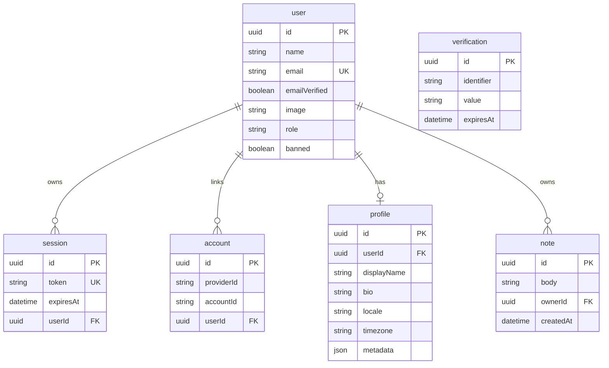
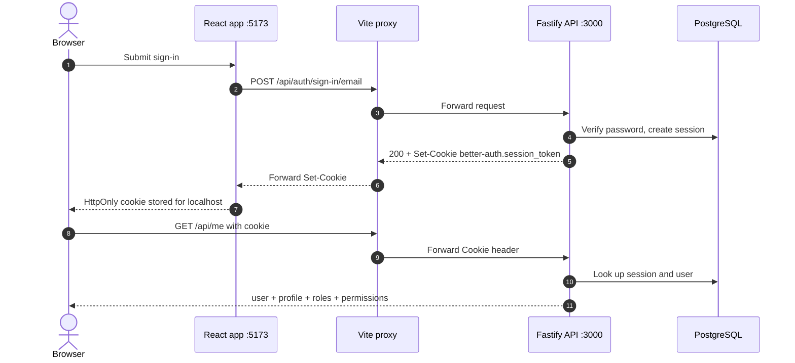

# Authentication and authorization

This document describes the default auth model, how to protect routes, how to extend profiles and permissions, and how to connect an identity provider.

The default is **Better Auth with cookie sessions**, a separate `Profile` table, and **global roles only**:

| Decision                | Default                                     |
| ----------------------- | ------------------------------------------- |
| Session transport       | `better-auth.session_token` httpOnly cookie |
| Bearer tokens           | Not enabled                                 |
| Roles                   | `user`, `moderator`, `admin`, `superadmin`  |
| Default role on sign-up | `user`                                      |
| Default admin           | None                                        |
| Profile storage         | `Profile` table, 1:1 with `User`            |
| Avatar storage          | `User.image` URL; no uploads                |
| Organisations/groups    | Deferred to Phase 11                        |

**Contents**

1. [File map](#1-file-map)
2. [Data model](#2-data-model)
3. [Cookie and session flow](#3-cookie-and-session-flow)
4. [Roles and permissions](#4-roles-and-permissions)
5. [Protecting routes](#5-protecting-routes)
6. [Profiles and avatars](#6-profiles-and-avatars)
7. [Roles, permissions and assignment](#7-roles-permissions-and-assignment)
8. [Admin bootstrap](#8-admin-bootstrap)
9. [Identity providers](#9-identity-providers)
10. [Local Keycloak recipe](#10-local-keycloak-recipe)
11. [CAS and SAML](#11-cas-and-saml)
12. [Security checklist](#12-security-checklist)
13. [Migrations and regeneration](#13-migrations-and-regeneration)
14. [Future: organisations and groups](#14-future-organisations-and-groups)

---

## 1. File map

| File                                                 | Responsibility                                                                    |
| ---------------------------------------------------- | --------------------------------------------------------------------------------- |
| `apps/api/src/auth/auth.ts`                          | Builds the Better Auth instance and plugins                                       |
| `apps/api/src/auth/auth.cli.ts`                      | CLI adapter: exports an auth instance for `auth:generate` and `auth:create-admin` |
| `apps/api/src/auth/permissions.ts`                   | Access-control statement, roles, role helpers                                     |
| `apps/api/src/auth/auth.guard.ts`                    | `authenticate`, `authorize`, `requireRole`, `request.auth`                        |
| `apps/api/src/auth/auth.routes.ts`                   | Public `/api/auth/config` and the Better Auth catch-all                           |
| `apps/api/src/modules/profile/profile.schemas.ts`    | Profile, update-profile and `/api/me` schemas                                     |
| `apps/api/src/modules/profile/profile.repository.ts` | Prisma access for profiles                                                        |
| `apps/api/src/modules/profile/profile.service.ts`    | `getOrCreate`, profile updates, DTO mapping, avatar resolution                    |
| `apps/api/src/modules/profile/profile.routes.ts`     | `GET /api/me`, `PATCH /api/me/profile`                                            |
| `apps/api/src/modules/admin/admin.service.ts`        | Role and ban policy, Better Auth admin calls, user DTO mapping                    |
| `apps/api/src/modules/admin/admin.routes.ts`         | Guarded role and ban/unban routes                                                 |
| `apps/api/prisma/schema.prisma`                      | Better Auth tables, `Profile`, `Note`                                             |
| `apps/web/src/auth-client.ts`                        | Better Auth browser client                                                        |
| `apps/web/src/api.ts`                                | Typed domain API client                                                           |
| `apps/web/src/ProfilePanel.tsx`                      | Profile editing and avatar preview                                                |
| `apps/web/src/AdminPanel.tsx`                        | Admin user list, role changes, bans                                               |

### Two API surfaces

There are two surfaces, on purpose:

1. **Better Auth routes** under `/api/auth/*` are handled by the catch-all in `auth.routes.ts`. Sign-up, sign-in, sign-out, sessions, read-only admin listing and plugin endpoints live here. The catch-all is hidden from the generated domain OpenAPI spec.
2. **Domain routes** such as `/api/me`, `/api/me/profile`, `/api/admin/users/:id/role`, `/api/admin/users/:id/ban` and `/api/notes` are normal Fastify routes with Zod schemas. They appear in `/docs` and in `packages/api-client`.

The web app uses `better-auth/react` for surface 1 and `packages/api-client` for surface 2. Role and ban changes are deliberately domain routes so the policy is visible, testable and typed. Better Auth's raw admin **mutation** endpoints are disabled in `auth.ts`; only read-only admin endpoints remain reachable through the catch-all.

---

## 2. Data model



| Table          | Purpose                            | Notes                                           |
| -------------- | ---------------------------------- | ----------------------------------------------- |
| `user`         | Identity and global role           | Better Auth-owned; `role` is a string           |
| `session`      | Server-side sessions               | Cookie token points here                        |
| `account`      | Credentials and OAuth links        | One row per provider                            |
| `verification` | Email/OTP verification tokens      | Better Auth-owned                               |
| `profile`      | Application profile                | One row per user, created on first read         |
| `Note`         | Demo resource for ownership checks | Table name is `Note`; its `ownerId` is nullable |

Better Auth IDs use PostgreSQL UUID defaults:

```prisma
@default(dbgenerated("pg_catalog.gen_random_uuid()")) @db.Uuid
```

`advanced.database.generateId = 'uuid'` is set in `auth.ts` so the adapter and the database agree.

`Profile.userId` is unique. Deleting a user cascades to sessions, accounts and the profile. Deleting a user sets `Note.ownerId` to `NULL`; unowned notes are only visible to `note:manage` holders.

---

## 3. Cookie and session flow



Properties of the default flow:

- The cookie is **httpOnly** and cannot be read by JavaScript.
- It is **SameSite=Lax**, `Path=/`, and observed with a seven-day `Max-Age`.
- The API uses server-side sessions; the cookie is a token, not a JWT.
- The Vite `/api` proxy makes the browser talk only to `http://localhost:5173`, so there is no CORS preflight in development.
- The typed client sets `credentials: 'include'`; the Better Auth client does the same for its own routes.
- In production, serve web and API from one origin behind a reverse proxy, or configure CORS deliberately.
- Over HTTPS, Better Auth can use `Secure` and `__Secure-` cookies; set `BETTER_AUTH_URL` to the HTTPS origin and keep `TRUSTED_ORIGINS` exact.

`authenticate` calls `auth.api.getSession` with the forwarded request headers. It stores the result on `request.auth` for the rest of the request, so subsequent guards do not query the session again.

`GET /api/me` returns the session user, the profile, the global roles, a small permission summary (`canManageUsers`, `canManageNotes`, `canManageSystem`) and the resolved `avatarUrl`. The web app uses `canManageUsers` to decide whether to render the admin panel and re-fetches this endpoint after a page refresh; the cookie makes the session survive the refresh.

---

## 4. Roles and permissions

Permissions are code-defined in `permissions.ts`:

```ts
export const statement = {
  ...defaultStatements,
  profile: ['read', 'update'],
  note: ['create', 'read', 'update', 'delete', 'manage'],
  system: ['manage'],
} as const;
```

`defaultStatements` comes from the Better Auth admin plugin and covers `user` and `session` actions.

### Permission matrix

| Capability                              | `user` | `moderator` | `admin` | `superadmin` | Exposed by default                     |
| --------------------------------------- | ------ | ----------- | ------- | ------------ | -------------------------------------- |
| Read/update own profile                 | Yes    | Yes         | Yes     | Yes          | `/api/me`                              |
| Create/read/update/delete notes         | Yes    | Yes         | Yes     | Yes          | `/api/notes`                           |
| Manage any note (`note:manage`)         | No     | Yes         | Yes     | Yes          | Service gate on the notes routes       |
| List/get users                          | No     | Yes         | Yes     | Yes          | Read-only Better Auth admin endpoints  |
| Create users                            | No     | No          | Yes     | Yes          | No — permission only                   |
| Set roles / ban / unban                 | No     | No          | Yes     | Yes          | `/api/admin/users/:id/role` and `/ban` |
| Impersonate users                       | No     | No          | Yes     | Yes          | No — permission only                   |
| Impersonate admins                      | No     | No          | No      | Yes          | No — permission only                   |
| Delete users / set password / set email | No     | No          | Yes     | Yes          | No — permission only                   |
| List/revoke/delete sessions             | No     | No          | Yes     | Yes          | List only; revoke/delete disabled      |
| System management (`system:manage`)     | No     | No          | No      | Yes          | No route yet                           |

Notes:

- `moderator` gets `user:get` and `user:list` but **not** `user:set-role` or `user:ban`.
- `admin` includes the admin plugin's `adminAc` user and session actions. The template disables the raw HTTP endpoints for the actions that have no guarded domain route (create, update, delete, set-password, impersonate, revoke sessions), so those permissions are not externally reachable by default.
- `superadmin` adds `user:impersonate-admins` and `system:manage`.
- `role` can technically hold comma-separated values; `parseRoles` normalises them. The default UI assigns one role.

### Permission gates

The auth instance is created with:

```ts
admin({ ac, roles, defaultRole: 'user' });
```

This makes the same `roles` object authoritative for both Better Auth admin endpoints and `auth.api.userHasPermission`.

---

## 5. Protecting routes

### Authenticated route

```ts
app.get(
  '/api/me',
  {
    preHandler: [app.authenticate],
    schema: { security: [{ cookieAuth: [] }] },
  },
  handler,
);
```

`authenticate` returns 401 and stops the handler when there is no session.

### Permission-protected route

```ts
app.patch(
  '/api/notes/:id',
  {
    preHandler: [app.authenticate, app.authorize('note', ['update'])],
    schema: { security: [{ cookieAuth: [] }] },
  },
  handler,
);
```

`authorize` checks the permission through `auth.api.userHasPermission`. For an unknown role or a failed check it returns 403.

### Role-protected route

```ts
app.get(
  '/api/admin/audit',
  {
    preHandler: [app.authenticate, app.requireRole('admin', 'superadmin')],
  },
  handler,
);
```

`requireRole` is a coarse gate. Prefer permissions for new resources; use roles when the route is inherently about a role level.

### Conditional permission checks

When a route must allow two different behaviours, such as "own notes by default, all notes for managers", check the permission in the handler:

```ts
const result = await auth.api.userHasPermission({
  body: {
    userId: request.auth.user.id,
    permissions: { note: ['manage'] },
  },
});

const canManage = result.success;
```

`notes.routes.ts` uses this for `?scope=all`. A non-manager receives 403; a manager receives all notes.

### Ownership checks

Ownership belongs in the service, not only the route:

```ts
if (!canManage && note.ownerId !== request.auth.user.id) {
  return null;
}
```

Return **404** for a resource the caller cannot see. It avoids revealing whether another user's row exists. A manager bypasses the ownership check.

### OpenAPI

Add `security: [{ cookieAuth: [] }]` to protected routes. The `cookieAuth` scheme is registered once in `app.ts`:

```ts
cookieAuth: {
  type: 'apiKey',
  in: 'cookie',
  name: 'better-auth.session_token',
}
```

Better Auth's own routes are hidden from the domain OpenAPI spec. Keep custom policy routes in the domain API so they are typed and documented.

---

## 6. Profiles and avatars

### Profile lifecycle

`GET /api/me` calls `getOrCreate(userId)`:

1. Return the existing profile if present.
2. Otherwise read the Better Auth user's `name`.
3. Create one `Profile` row with `displayName = user.name`.
4. Use `createMany({ skipDuplicates: true })` so concurrent first reads cannot create duplicates.

`PATCH /api/me/profile`:

- Updates `displayName`, `bio`, `locale`, `timezone` and `metadata` through `profile.service.ts`; all Prisma access stays in `profile.repository.ts`.
- Updates `User.image` through `auth.api.updateUser` when `image` is present.
- Returns the full `/api/me` payload.
- Uses `app.authenticate` and `app.authorize('profile', ['update'])`.

### Add a profile field

For a first-class, queryable field, add a column:

1. Add the field to `Profile` in `prisma/schema.prisma`.
2. Add it to `profileSchema` and `updateProfileSchema` in `profile.schemas.ts`.
3. Add it to `toDto` in `profile.service.ts`.
4. Add the request mapping in `profile.routes.ts`.
5. Add the form control in `apps/web/src/ProfilePanel.tsx`.
6. Run:

```bash
pnpm --filter api db:migrate --name add-profile-field
pnpm --filter api db:generate
pnpm gen:api
pnpm typecheck
```

Use `metadata` for experimental or user-defined values that do not need a column:

- No migration.
- Bounded to 4096 serialized characters by `metadataSchema`.
- Not indexed and not schema-validated beyond being a JSON object.
- Do not store secrets, permissions or security decisions there.

### Avatar rules

The only stored avatar is `User.image`; there is no `Profile.avatarUrl` column.

- **URL only in v1.** No file uploads, no multipart handling, no object storage.
- The update schema accepts an optional URL up to 2048 characters; send `null` to clear it.
- The server resolves `avatarUrl` in `profile.service.ts`:
  1. `User.image` when set.
  2. Otherwise a Gravatar URL derived from `email.trim().toLowerCase()` using MD5 and `d=identicon`.
  3. Otherwise `null`.
- The browser uses the server-provided `avatarUrl`; it must **not** compute Gravatar hashes.
- The web `Avatar` component falls back to initials when the URL is missing or fails to load.
- If an SSO provider returns a picture claim, Better Auth stores it in `User.image`; the same resolution applies.
- The profile panel previews a new image URL before saving by rendering that URL with the same initials fallback.

Gravatar privacy and CSP:

- The fallback sends an MD5 hash of the user's normalised email to `gravatar.com`. That is a privacy decision, not just a rendering detail.
- If your CSP restricts images, add `https://www.gravatar.com` to `img-src`, or disable the fallback.
- To disable the fallback, change `resolveAvatarUrl` to return the explicit image only:

```ts
export function resolveAvatarUrl(user: AvatarUser): string | null {
  return user.image ?? null;
}
```

The UI then shows initials whenever `User.image` is empty. No database change is needed.

---

## 7. Roles, permissions and assignment

### Add a permission

1. Add the resource and actions to `statement` in `permissions.ts`.
2. Add those actions to each role that should have them. `ac` is created from the full statement, so unknown resources fail type checking.
3. If the action should be exposed as a route gate, call `app.authorize('<resource>', ['<action>'])`.
4. Add tests and update this matrix.
5. Run `pnpm typecheck` and `pnpm gen:api` if the route contract changed.

### Add a role

```ts
export const auditor = ac.newRole({
  profile: ['read'],
  note: ['read'],
  user: ['get', 'list'],
  session: [],
  system: [],
});

export const roles = {
  user,
  moderator,
  admin,
  superadmin,
  auditor,
} as const;
```

Then:

- Add the role to `ASSIGNABLE_ROLES` if the admin API/UI may assign it.
- Update `canChangeUserRole` if it needs special authority rules.
- Add it to the role select in `AdminPanel.tsx`.
- Update this permission matrix.
- No database migration is required: `role` is a string.

If the role should call Better Auth admin endpoints, include the relevant `adminAc.statements` entries, as `admin` and `superadmin` do.

### Who may change roles

The guarded route is:

```text
POST /api/admin/users/:id/role
Body: { "role": "user" | "moderator" | "admin" }
```

It is protected by:

```ts
preHandler: [app.authenticate, app.authorize('user', ['set-role'])];
```

`canChangeUserRole` enforces:

- The actor must be `admin` or `superadmin`.
- The actor cannot change their own role.
- The target cannot be `superadmin`.
- The next role must be assignable (`user`, `moderator`, `admin`).

`admin.service.ts` loads the target with `auth.api.getUser`, applies `canChangeUserRole`, and then calls `auth.api.setRole`. The web app calls this route, not `authClient.admin.setRole`.

`superadmin` is bootstrap-only in the intended flow. It is not in the domain route's request enum, not in the web role select, and cannot be a target of this route. Use the CLI or a controlled database operation to create the first one.

Better Auth also exposes its own `POST /api/auth/admin/set-role` endpoint. That endpoint accepts any configured role, including `superadmin`, and would bypass `canChangeUserRole`. `auth.ts` therefore disables the raw admin mutation paths (`DISABLED_ADMIN_PATHS`), including `set-role`, `ban-user`, `unban-user`, `create-user`, `update-user`, `remove-user`, `set-user-password`, impersonation and session revocation. Only read-only admin endpoints (`list-users`, `get-user`, `has-permission`, `list-user-sessions`) remain reachable through the catch-all.

### Ban and unban

The guarded domain route is:

```text
POST /api/admin/users/:id/ban
Body: { "banned": true, "reason": "spam" }
```

It is protected by:

```ts
preHandler: [app.authenticate, app.authorize('user', ['ban'])];
```

`canModerateUser` enforces:

- The actor must be `admin` or `superadmin`.
- The actor cannot ban or unban themselves.
- The target cannot be `superadmin`.

The route calls `auth.api.banUser` or `auth.api.unbanUser` after the policy check. Banning deletes the target's sessions. The admin panel lists users through `GET /api/auth/admin/list-users`, but sends ban changes through this domain route, not `authClient.admin.banUser`. Hiding or disabling a UI control is not the security boundary.

### Deliberate scope reduction

Disabling the raw mutations means v1 does **not** expose every capability granted to `admin` and `superadmin`:

- Exposed: list/get users, change role, ban/unban.
- Not exposed: create/update/remove users, set password/email, impersonate, revoke or delete sessions.

The permission matrix records the underlying permissions, and the “Exposed by default” column records the actual HTTP surface. To expose a disabled capability, add a guarded domain route with its own policy and tests, then remove only that path from `DISABLED_ADMIN_PATHS`. Do not re-enable a raw admin mutation and rely on the UI to hide it.

---

## 8. Admin bootstrap

There is **no default admin** and no seeded password. Sign-up always creates `role = "user"`.

Create an admin with the CLI:

```bash
pnpm --filter api auth:create-admin \
  --email admin@example.com \
  --name "Admin" \
  --role admin
```

The CLI may prompt for a password. Use `--role superadmin` only for the break-glass account; the API and UI cannot assign that role.

If the CLI is unavailable, bootstrap through Prisma Studio or SQL, then sign in again:

```sql
UPDATE "user" SET role = 'admin' WHERE email = 'admin@example.com';
```

Keep at least one break-glass superadmin outside the daily UI flow. Store its credentials in a secret manager and rotate them. Do not add a default password or a seeded admin to the template.

Verify the bootstrap with:

```bash
curl -i http://localhost:3000/api/me
```

after signing in, or check `permissions.canManageUsers` in the response.

---

## 9. Identity providers

OIDC providers are configured entirely through environment variables. The server creates a Better Auth `genericOAuth` provider at startup when the required values are present.

### Configuration matrix

| Variable                      | Required | Default                | Purpose                                      |
| ----------------------------- | -------- | ---------------------- | -------------------------------------------- |
| `AUTH_EMAIL_PASSWORD_ENABLED` | No       | `true`                 | Enable email/password sign-in                |
| `AUTH_SSO_PROVIDER_ID`        | With SSO | —                      | Provider ID used in the callback path        |
| `AUTH_SSO_DISCOVERY_URL`      | With SSO | —                      | OIDC discovery document                      |
| `AUTH_SSO_CLIENT_ID`          | With SSO | —                      | OAuth client ID                              |
| `AUTH_SSO_CLIENT_SECRET`      | No       | —                      | Client secret; omit for a public/PKCE client |
| `AUTH_SSO_SCOPES`             | No       | `openid,profile,email` | Comma-separated scopes                       |
| `AUTH_SSO_LABEL`              | No       | provider ID            | Button label returned by `/api/auth/config`  |

All `AUTH_SSO_*` values are validated together. If any are set, `providerId`, `discoveryUrl` and `clientId` are required. The IdP origin is added to `TRUSTED_ORIGINS` automatically; the web origin must already be there.

### Callback URL

The exact callback is:

```text
{BETTER_AUTH_URL}/api/auth/callback/{AUTH_SSO_PROVIDER_ID}
```

For the default local setup:

```text
http://localhost:3000/api/auth/callback/keycloak
```

Register that exact URL with the IdP. A trailing slash or a different port is a different URL.

### Public configuration endpoint

`GET /api/auth/config` returns:

```json
{
  "emailPassword": { "enabled": true },
  "sso": {
    "enabled": true,
    "providerId": "keycloak",
    "label": "Company SSO"
  }
}
```

`sso.enabled` reports whether the provider was **actually registered after startup discovery**, not merely whether the `AUTH_SSO_*` variables are set. If discovery failed, the endpoint returns `sso.enabled: false` even though the environment is configured; check the API logs. The web app renders the SSO button only when `sso.enabled` is true and `providerId` is present. It starts the flow with `authClient.signIn.social({ provider: providerId })`; generic OAuth providers use the standard social sign-in method.

### Startup discovery

Better Auth resolves the OIDC discovery document when the API starts. The IdP must be reachable at that moment. If it is not, the provider is skipped and no SSO button is available. Start the IdP first, then restart the API after changing SSO environment variables.

### Email linking

Treat an email address from an IdP as an identity claim, not proof of ownership. Review Better Auth's `accountLinking` and trusted-provider settings before allowing automatic linking to an existing local account. Require verified email at the IdP, and do not link untrusted providers to accounts with the same address.

### Role claims

Roles in this template are local. The IdP does not set them, and the generic OAuth config does not map a role claim. If you add mapping, accept only known role names and never trust an arbitrary claim to grant `admin` or `superadmin`.

---

## 10. Local Keycloak recipe

This is a development-only recipe. It is not part of the default compose file. It is verified against Keycloak 26.0.8 with local email/password enabled; both login paths coexist without code changes.

### 1. Add Keycloak

```yaml
services:
  keycloak:
    image: quay.io/keycloak/keycloak:26.0
    command: start-dev
    environment:
      KC_BOOTSTRAP_ADMIN_USERNAME: admin
      KC_BOOTSTRAP_ADMIN_PASSWORD: admin
      KC_HOSTNAME: http://keycloak.localhost:8080
    ports:
      - '8080:8080'
```

Add the SSO values and a host-gateway mapping to the existing `app` service so the API container receives the configuration and resolves the same issuer the browser uses:

```yaml
services:
  app:
    environment:
      AUTH_SSO_PROVIDER_ID: keycloak
      AUTH_SSO_DISCOVERY_URL: http://keycloak.localhost:8080/realms/dev/.well-known/openid-configuration
      AUTH_SSO_CLIENT_ID: fullstack
      AUTH_SSO_CLIENT_SECRET: ${AUTH_SSO_CLIENT_SECRET}
      AUTH_SSO_SCOPES: openid,profile,email
      AUTH_SSO_LABEL: Company SSO
    extra_hosts:
      - 'keycloak.localhost:host-gateway'
```

Put the client secret in `.devcontainer/.env`, and keep the `${AUTH_SSO_CLIENT_SECRET}` entry in the `app.environment` block shown above; Compose only passes variables listed there (or in an `env_file`). If you add the secret to `.env` without the `environment` entry, the API never sees it. For a public/PKCE client, omit the `AUTH_SSO_CLIENT_SECRET` entry entirely rather than leaving it empty.

### 2. Create the realm and client

1. Open `http://keycloak.localhost:8080` and sign in as `admin` / `admin`.
2. Create realm `dev`.
3. Create an OpenID Connect client named `fullstack`.
4. Set **Valid redirect URIs** to `http://localhost:3000/api/auth/callback/keycloak`.
5. Set **Web origins** to `http://localhost:5173` or `+`.
6. For a confidential client, enable client authentication and copy the secret.
   For a public client, disable it and leave `AUTH_SSO_CLIENT_SECRET` unset; Better Auth uses PKCE.

### 3. Callback URL

The exact callback is:

```text
http://localhost:3000/api/auth/callback/keycloak
```

It comes from `{BETTER_AUTH_URL}/api/auth/callback/{AUTH_SSO_PROVIDER_ID}`. If you change the API port or provider ID, update the Keycloak client's valid redirect URI to match. A trailing slash or a different hostname is a different URI and will produce a redirect-URI error.

### 4. Configure the API

```dotenv
AUTH_SSO_PROVIDER_ID=keycloak
AUTH_SSO_DISCOVERY_URL=http://keycloak.localhost:8080/realms/dev/.well-known/openid-configuration
AUTH_SSO_CLIENT_ID=fullstack
AUTH_SSO_CLIENT_SECRET=change-me
AUTH_SSO_SCOPES=openid,profile,email
AUTH_SSO_LABEL=Company SSO
```

Start Keycloak first, then restart the API after setting these values. Better Auth resolves the OIDC discovery document when the API starts. If Keycloak is down, the discovery URL is wrong, or the container cannot resolve the hostname, the provider is skipped and no SSO button appears. Changing the SSO environment or Keycloak's hostname requires another API restart.

Check the public configuration before opening the web app:

```bash
curl -s http://localhost:3000/api/auth/config
```

The response should include `"sso": { "enabled": true, "providerId": "keycloak", ... }`. The SSO button uses `authClient.signIn.social({ provider: "keycloak" })`; no application code changes are needed.

### Hostname guidance

| Context         | Use                                                                          |
| --------------- | ---------------------------------------------------------------------------- |
| Browser         | `http://keycloak.localhost:8080`                                             |
| API container   | `http://keycloak.localhost:8080` with the `host-gateway` mapping             |
| API on the host | `http://localhost:8080`                                                      |
| Avoid           | `http://keycloak:8080` in discovery when the browser sees a different issuer |

The issuer in the discovery document must match on both sides. If the browser sees `keycloak.localhost` but the API sees `keycloak`, the callback or token validation fails with an issuer mismatch. Set `KC_HOSTNAME` and use the same public URL everywhere.

If your browser does not resolve `*.localhost`, add an entry to the host file:

```text
127.0.0.1 keycloak.localhost
```

`host.docker.internal` is useful for container-to-host calls, but it is not a browser-facing issuer. Do not use it in `AUTH_SSO_DISCOVERY_URL` unless the browser can resolve the same value. Mixing `host.docker.internal` for the API with `keycloak.localhost` for the browser is an issuer mismatch.

### Troubleshooting the recipe

| Symptom                                               | Likely cause                                              | Fix                                                                                     |
| ----------------------------------------------------- | --------------------------------------------------------- | --------------------------------------------------------------------------------------- |
| `Invalid environment: … AUTH_SSO_DISCOVERY_URL`       | partial SSO configuration                                 | set `AUTH_SSO_PROVIDER_ID`, `AUTH_SSO_DISCOVERY_URL` and `AUTH_SSO_CLIENT_ID` together  |
| SSO button missing / `/api/auth/config` says disabled | discovery failed at API startup                           | start Keycloak, verify the discovery URL from inside the app container, restart the API |
| `redirect_uri` mismatch at Keycloak                   | callback URL differs                                      | register exactly `http://localhost:3000/api/auth/callback/keycloak`                     |
| `unexpected issuer` or token validation error         | browser and API see different issuer hostnames            | set `KC_HOSTNAME` to `http://keycloak.localhost:8080` and use the same URL in discovery |
| `ENOTFOUND keycloak.localhost` from the API           | no host-gateway mapping                                   | add `extra_hosts: ['keycloak.localhost:host-gateway']` to the app service               |
| Browser cannot open `keycloak.localhost`              | host resolver does not expand `*.localhost`               | add `127.0.0.1 keycloak.localhost` to the host file                                     |
| Login redirects to the wrong host                     | `BETTER_AUTH_URL` does not match the browser's API origin | set it to `http://localhost:3000` in development                                        |

---

## 11. CAS and SAML

CAS and SAML are not native dependencies of this template.

- **CAS:** put an OIDC bridge in front of CAS. Keycloak can broker CAS, or use another CAS-to-OIDC gateway. Point Better Auth at the bridge's OIDC discovery document. The browser should only talk to the OIDC provider, never directly to a CAS client inside the app.
- **SAML:** use an OIDC-capable broker (Keycloak, Entra ID, Auth0) that federates the SAML IdP, then connect Better Auth over OIDC. Adding a SAML plugin directly is an explicit extension and is not covered by the default dependency set.

Both approaches keep the app on the single `genericOAuth` path and avoid a second session model.

---

## 12. Security checklist

- [ ] `BETTER_AUTH_SECRET` is at least 32 random characters and comes from a secret manager.
- [ ] Production uses HTTPS; cookies are `Secure`; `BETTER_AUTH_URL` is the HTTPS origin.
- [ ] `TRUSTED_ORIGINS` contains exact origins; no wildcards.
- [ ] No default admin or seeded password exists.
- [ ] A break-glass superadmin exists outside the daily UI flow, with rotated credentials.
- [ ] Admin routes are protected on the server; hiding UI is not authorization.
- [ ] Role changes reject self-changes, superadmin targets and superadmin assignment.
- [ ] Ban/unban callers have `user:ban`; server policy rejects self and superadmin targets.
- [ ] OIDC discovery is reachable at startup and the issuer matches on both sides.
- [ ] Account linking and trusted providers are reviewed; IdP email is verified.
- [ ] IdP role claims, if mapped, are allow-listed and never grant superadmin blindly.
- [ ] Gravatar is an accepted privacy trade-off; CSP includes it or the fallback is disabled.
- [ ] `/docs` is protected in production.
- [ ] Email verification, password reset, MFA and rate limiting are added before production.
- [ ] Admin actions and bootstrap are audited, backed up and tested.
- [x] Role assignment, self/superadmin moderation and note ownership have unit/route tests (`pnpm --filter api test`).
- [ ] The full auth flow is covered by integration tests against a live database.

---

## 13. Migrations and regeneration

Prisma migrations are not committed to the template. The first migration is created after scaffolding.

### First setup

```bash
pnpm --filter api db:migrate --name init
pnpm --filter api db:generate
pnpm gen:api
```

Once that migration is committed, later environments (another machine, a fresh Codespace, a recreated database volume) have an empty database and must replay it instead of authoring a new one:

```bash
pnpm --filter api db:deploy
```

`db:deploy` applies pending migrations only; `db:migrate` compares `schema.prisma` with the database and would try to create a second migration. Users and sessions live in the database, so `auth:create-admin` must also be re-run per new database.

### After changing the application schema

```bash
pnpm --filter api db:migrate --name add-profile-field
pnpm --filter api db:generate
pnpm gen:api
pnpm typecheck
```

### After changing Better Auth configuration

If you add a plugin, a field or an auth option that changes Better Auth's tables:

```bash
pnpm --filter api auth:generate
pnpm --filter api db:migrate --name auth-schema-change
pnpm --filter api db:generate
pnpm gen:api
pnpm typecheck
```

`auth:generate` runs the Better Auth CLI with `src/auth/auth.cli.ts`. The app builds auth through `createAuth(prisma, config)`, but the CLI requires a module-level auth instance; `auth.cli.ts` loads the environment and Prisma client and exports one. Review the generated schema diff; do not hand-edit Better Auth-owned tables without a reason.

`pnpm gen:api` is required whenever a domain route or Zod schema changes. Better Auth's catch-all routes are not part of that generated contract, so changes there do not appear in `packages/api-client`.

---

## 14. Future: organisations and groups

V1 is **roles-only**. There is no organisation plugin, no organisation/member/invitation tables, no organisation selector and no tenant assumption in the UI.

Phase 11 will design organisations/groups. That work will need:

- Better Auth's organisation plugin or an equivalent membership model.
- Schema generation and migrations for organisations, members and invitations.
- Organisation-scoped roles and a decision about how they compose with global roles.
- Tenant scoping in every service and query.
- Invitation, membership and switching UI.
- Tests for cross-organisation isolation.

Do not add half-built group controls before that design. The current `space-y-4` panel layout can accept another panel without changing the auth model.
